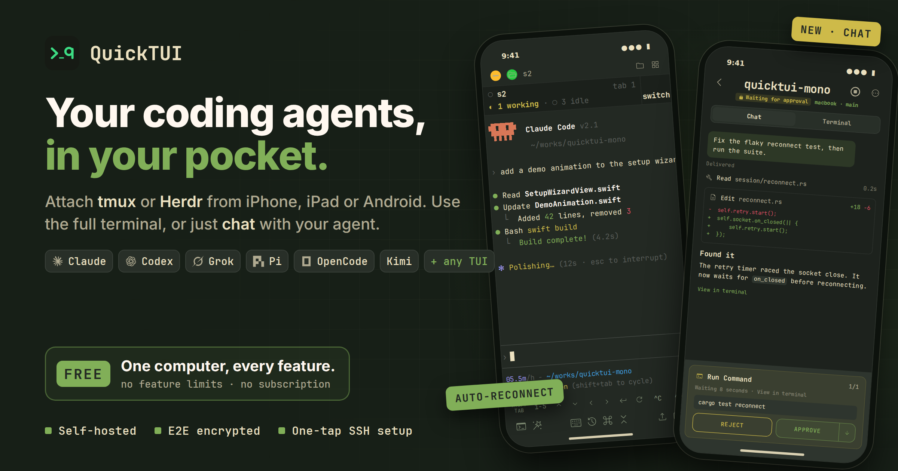
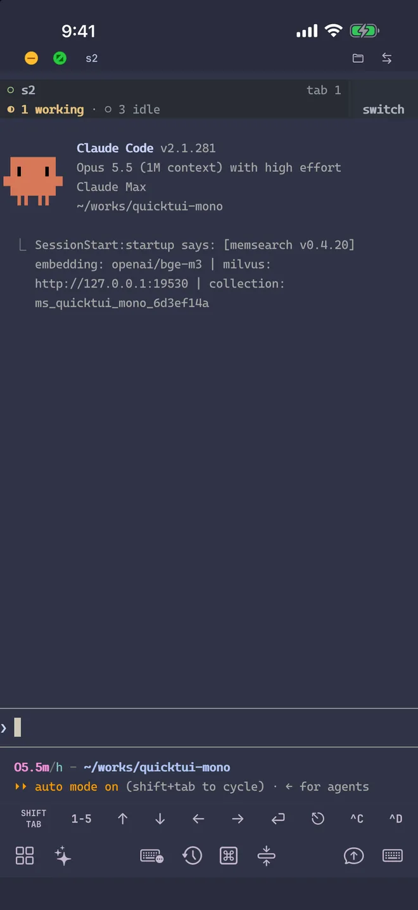
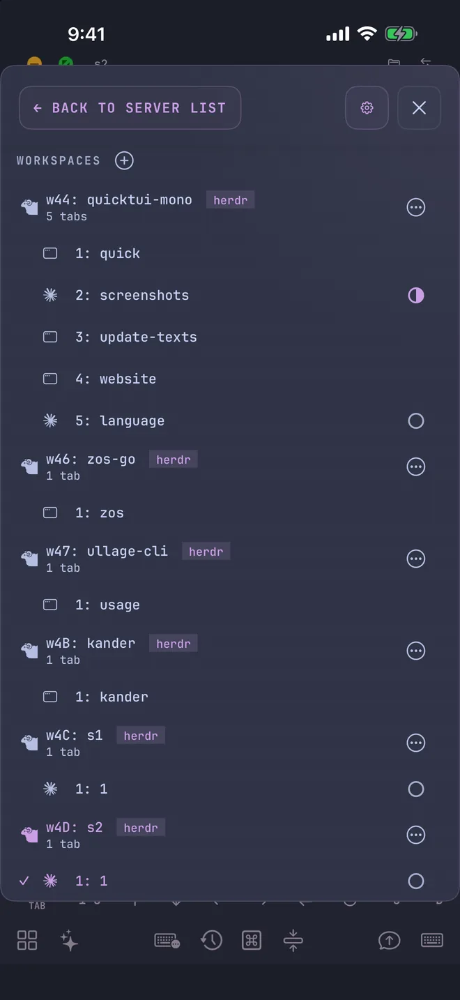
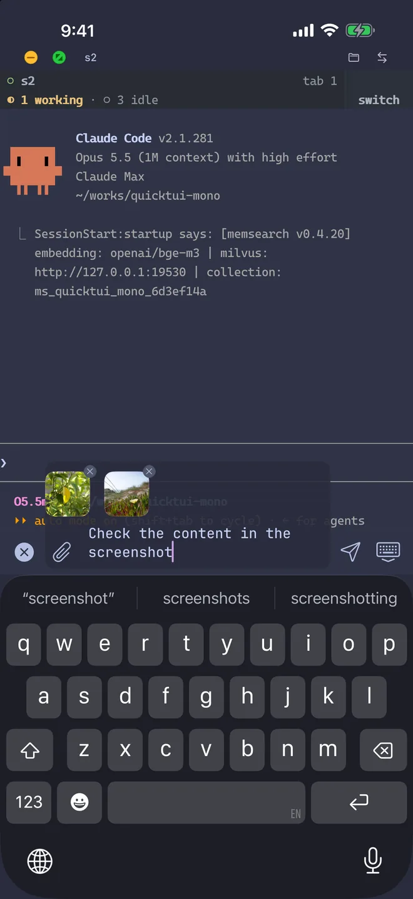

# QuickTUI for Herdr

**Use your Herdr sessions from your iPhone or Android phone.** This plugin
installs [QuickTUI](https://quicktui.ai/?ref=herdr) with one confirmed step and
pairs your phone with a QR code, right inside Herdr.



<p>
  
  
  
</p>

## Why QuickTUI

- **Native mobile apps**: real iOS and Android clients, not a web terminal in a
  browser tab
- **Pair in seconds**: scan a QR code from the QuickTUI Pairing QR pane
- **Reach your machine from anywhere**: the optional QuickTUI Relay is end-to-end
  encrypted and needs no Tailscale, VPN, or port forwarding
- **Built for agents**: run Claude Code, Codex, or any CLI agent in Herdr and
  check on it from your phone

Get the app:

- iPhone / iPad: [App Store](https://apps.apple.com/app/quicktui/id6761338192)
- Android: [quicktui.ai/android](https://quicktui.ai/android/?ref=herdr)

Supported hosts: macOS and Linux. Minimum Herdr version: **0.8.0**.

## Install the plugin

```sh
herdr plugin install quicktui/quicktui-herdr
```

On its first start, the plugin tries to show one QuickTUI toast in Herdr that
points you to the next step. It records that the toast was shown only after
Herdr accepts it. Without `python3`, or when the toast command fails, nothing is
recorded and the plugin tries again on the next start.

## Use it

| Entry | ID | What it does |
| --- | --- | --- |
| QuickTUI Install | `ai.quicktui.install` | Asks for confirmation, then runs the official QuickTUI installer and opens pairing |
| QuickTUI Setup | `ai.quicktui.setup` | Missing: same confirmed install. Not running: start guide. Ready: `pairing welcome` |
| QuickTUI Pairing QR | `ai.quicktui.pair-qrcode` | Shows the official pairing QR code when QuickTUI Server is ready |
| Startup hook | `[[startup]]` | Bounded health check after Herdr starts, plus the first-run toast attempt; then exits |

Windows entries are documented separately once Windows support lands.

Run an entry from the command line:

```sh
herdr plugin action invoke ai.quicktui.install
herdr plugin action invoke ai.quicktui.setup
herdr plugin action invoke ai.quicktui.pair-qrcode
```

Or bind keys in your Herdr config:

```toml
[[keys.command]]
key = "prefix+q"
type = "plugin_action"
command = "ai.quicktui.pair-qrcode"
description = "QuickTUI pairing QR"

[[keys.command]]
key = "prefix+i"
type = "plugin_action"
command = "ai.quicktui.install"
description = "Install QuickTUI"
```

## What the install step runs

QuickTUI Install (and Setup, when QuickTUI is missing) shows the official URL
and waits for you to type `y` or `yes`. Only then does it:

1. Download `https://quicktui.ai/q.sh` over HTTPS into a private temporary
   directory, ignoring `~/.curlrc`. The directory is created under `TMPDIR`
   only when no other user can rename entries in it or its parents; otherwise
   under `/tmp`
2. Run it as your user with `sh <file>` (the same installer as
   `curl -fsSL https://quicktui.ai/q.sh | sh`)
3. Delete the temporary file and directory
4. Wait up to 10 seconds for QuickTUI Server, then open `pairing welcome`

Any other answer, or a pane without a TTY, downloads nothing. A failed download
or installer stops with an error and is not retried. The official installer
sets up `quicktui-server` and its user service; the plugin itself never starts
a daemon.

You can also install QuickTUI yourself:

```sh
curl -fsSL https://quicktui.ai/q.sh | sh
```

See [quicktui.ai/install](https://quicktui.ai/install/?ref=herdr).

## What the plugin does not do

- It does not download or run anything without your confirmation
- It does not start `quicktui-server` or any other daemon itself
- It does not save pairing codes, tokens, or identity material. Its state
  directory holds only a discovery status file and the time the toast was shown
- It does not take over a Herdr controller

## Custom QuickTUI installs

- `QUICKTUI_SERVER_BIN`: absolute `quicktui-server` path
- `QUICKTUI_CONFIG`: absolute `config.toml` path

Default discovery uses `$PATH`, `~/.local/bin/quicktui-server`,
`/usr/local/bin/quicktui-server`, and
`~/.config/quicktui-server-v2/config.toml`.

## Versioning

The plugin version matches the QuickTUI stable server release it was tested
with (for example `server2-20260929-02`).

## Development

```sh
herdr plugin link /absolute/path/to/quicktui-herdr
sh tests/run.sh
HERDR_BIN=/path/to/herdr sh tests/smoke-herdr-link.sh
```

Scripts are POSIX `sh`. Commands use argv. There is no `eval`.
Publishing steps are in [docs/publish.md](docs/publish.md).

## License

MIT. See [LICENSE](LICENSE).
