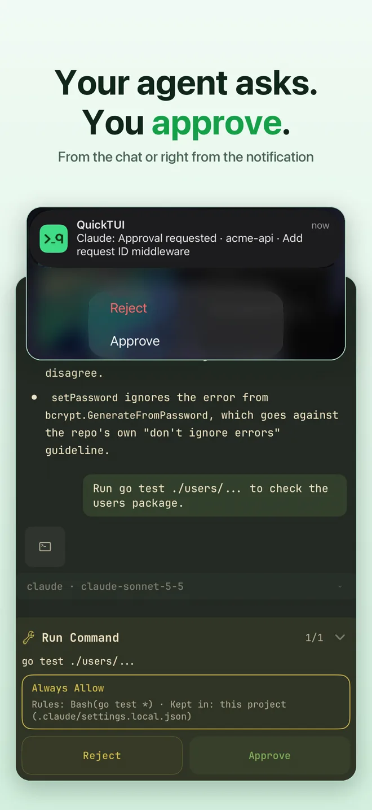
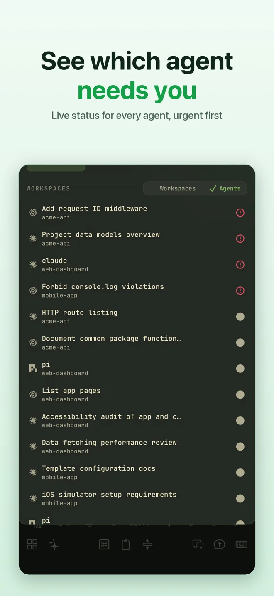
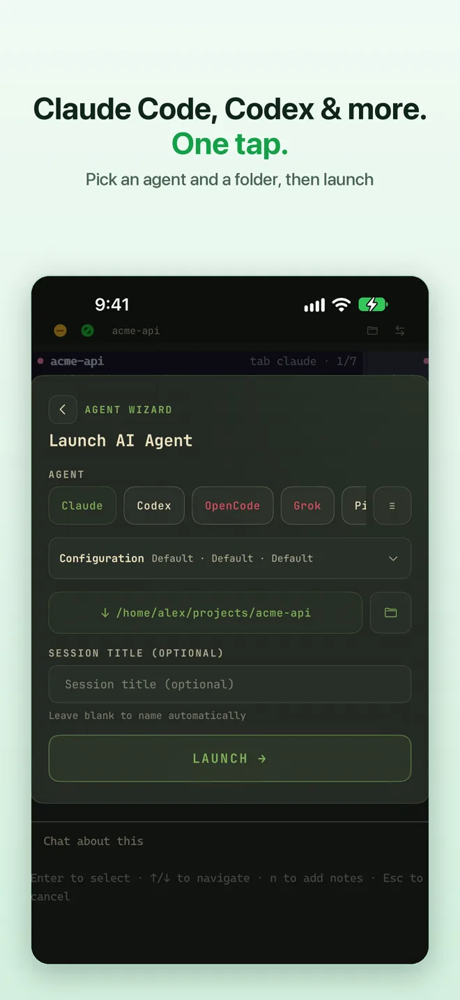
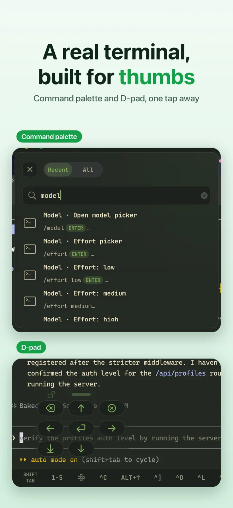
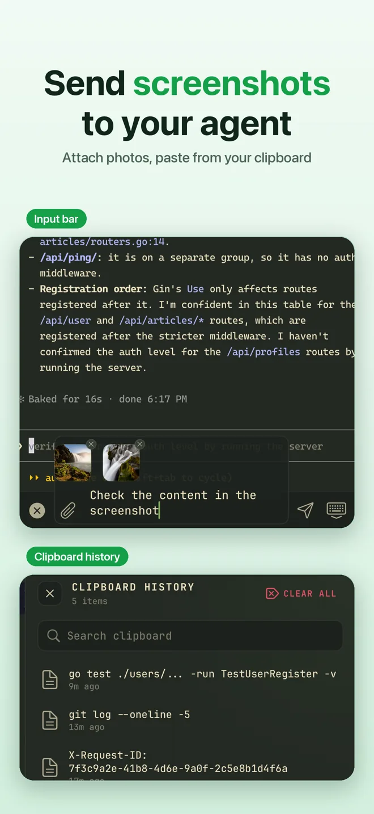
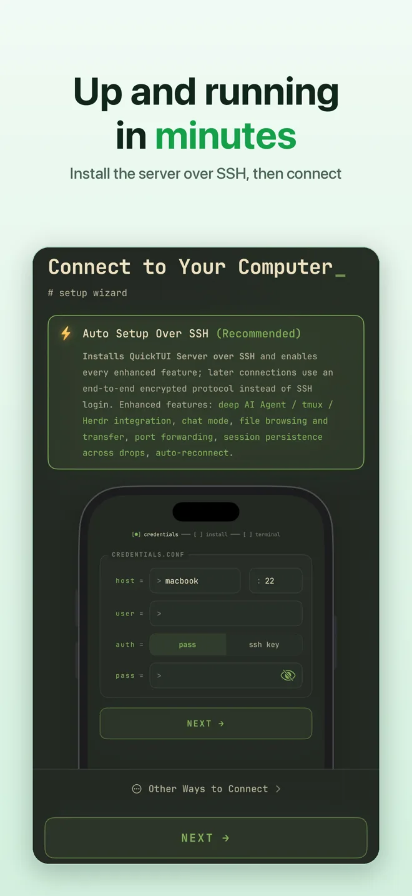

# QuickTUI for Herdr

**Run and steer your Herdr agents from your iPhone, iPad, or Android phone.**
Herdr keeps each AI coding agent running in its own terminal on your computer.
[QuickTUI](https://quicktui.ai/herdr-ios-app/?ref=herdr) opens those workspaces
on your phone, shows every agent's live state, and lets you approve, answer, or
take over the terminal whenever an agent needs you. This plugin installs
QuickTUI with one confirmed step and pairs your phone with a QR code, right
inside Herdr.


<p>
  
  
  
</p>
<p>
  
  
  
</p>

## Why QuickTUI

- **Know when an agent needs you**: get notified the moment an agent asks for
  approval or has a question, then approve or answer right from the
  notification or in chat
- **Every agent at a glance**: each Herdr tab shows its agent's live state
  (working, idle, waiting for input, or done), so you see which session needs
  attention first
- **Launch any agent in one tap**: the Agent Wizard starts Claude Code, Codex,
  OpenCode, Grok, Gemini, Cursor, Kimi, Qoder, or Pi in a new Herdr tab, in the
  folder you pick
- **Chat or terminal**: a chat mode with Markdown rendering, plus a full
  terminal with shortcut bars, a D-pad, and a command palette
- **Native mobile apps**: real iOS and Android clients, not a web terminal in a
  browser tab
- **Reach your computer from anywhere**: connect directly, or through QuickTUI
  Cloud when there is no public IP or port forwarding, end-to-end encrypted.
  Every account gets a free monthly Cloud data allowance
- **Your machine, your data**: each device pairs with its own key; your code,
  keys, and API quotas stay on your computer. Direct connections need no
  account

## How Herdr maps to the app

| Herdr | In QuickTUI | From your phone |
| --- | --- | --- |
| Workspace | Workspace, in the same order as Herdr's sidebar | Create and rename |
| Tab | Session, with an agent status icon | Create, rename, and close |
| Pane | Pane | Switch to, zoom, and close |

Splitting panes and changing layouts stay on your computer. The QuickTUI
server starts Herdr when needed, and disconnecting the app never stops Herdr
or closes a pane. tmux and Herdr can be enabled together.

## Get the app

- iPhone / iPad: [App Store](https://apps.apple.com/app/quicktui/id6761338192)
  (iOS 16.4 or later)
- Android: [quicktui.ai/android](https://quicktui.ai/android/?ref=herdr)
  (Preview, Android 8.0 or later)

QuickTUI is free for one computer, with every feature included. QuickTUI Pro,
a one-time purchase on iPhone and iPad, unlocks unlimited computers. The
Android Preview includes every feature for free. QuickTUI Cloud is optional.

Supported hosts: macOS, Linux, and Windows. Minimum Herdr version: **0.9.0**,
the oldest Herdr that QuickTUI Server supports.

## Install the plugin

```sh
herdr plugin install quicktui/quicktui-herdr
```

On its first start, the plugin tries to show one QuickTUI toast in Herdr that
points you to the next step. It records that the toast was shown only after
Herdr accepts it. Without `python3` (macOS / Linux), or when the toast command
fails, nothing is recorded and the plugin tries again on the next start.

## Use it

| Entry | macOS / Linux ID | Windows ID | What it does |
| --- | --- | --- | --- |
| QuickTUI Install | `ai.quicktui.install` | `ai.quicktui.install-windows` | Asks for confirmation, then runs the official QuickTUI installer and opens pairing |
| QuickTUI Setup | `ai.quicktui.setup` | `ai.quicktui.setup-windows` | Missing: same confirmed install. Not running: start guide. Ready: `pairing welcome` |
| QuickTUI Pairing QR | `ai.quicktui.pair-qrcode` | `ai.quicktui.pair-qrcode-windows` | Shows the official pairing QR code when QuickTUI Server is ready |
| Startup hook | `[[startup]]` | `[[startup]]` | Bounded health check after Herdr starts, plus the first-run toast attempt; then exits |

Herdr requires action and pane ids to be unique across platforms, so the
Windows entries carry a `-windows` suffix. Each platform only runs its own
entries.

Run an entry from the command line on macOS / Linux:

```sh
herdr plugin action invoke ai.quicktui.install
herdr plugin action invoke ai.quicktui.setup
herdr plugin action invoke ai.quicktui.pair-qrcode
```

On Windows:

```powershell
herdr plugin action invoke ai.quicktui.install-windows
herdr plugin action invoke ai.quicktui.setup-windows
herdr plugin action invoke ai.quicktui.pair-qrcode-windows
```

Or bind keys in your Herdr config (macOS / Linux):

```toml
[[keys.command]]
key = "prefix+q"
type = "plugin_action"
command = "ai.quicktui.pair-qrcode"
description = "QuickTUI pairing QR"

[[keys.command]]
key = "prefix+i"
type = "plugin_action"
command = "ai.quicktui.install"
description = "Install QuickTUI"
```

On Windows, use the `-windows` ids:

```toml
[[keys.command]]
key = "prefix+q"
type = "plugin_action"
command = "ai.quicktui.pair-qrcode-windows"
description = "QuickTUI pairing QR"

[[keys.command]]
key = "prefix+i"
type = "plugin_action"
command = "ai.quicktui.install-windows"
description = "Install QuickTUI"
```

## What the install step runs

QuickTUI Install (and Setup, when QuickTUI is missing) shows the official URL
and waits for you to type `y` or `yes`. Only then does it:

1. Download `https://quicktui.ai/q.sh` over HTTPS into a private temporary
   directory, ignoring `~/.curlrc`. The directory is created under `TMPDIR`
   only when no other user can rename entries in it or its parents; otherwise
   under `/tmp`
2. Run it as your user with `sh <file>` (the same installer as
   `curl -fsSL https://quicktui.ai/q.sh | sh`)
3. Delete the temporary file and directory
4. Wait up to 10 seconds for QuickTUI Server, then open `pairing welcome`

On Windows the same entries:

1. Download `https://quicktui.ai/q.ps1` over HTTPS (redirects must stay HTTPS)
   to a private temporary `.ps1` file
2. Run it as your user with
   `powershell.exe -NoProfile -ExecutionPolicy Bypass -File <file>` (the same
   installer as `irm https://quicktui.ai/q.ps1 | iex`; `-ExecutionPolicy
   Bypass` applies only to that one process)
3. Delete the temporary file
4. Wait up to 10 seconds for QuickTUI Server, then open `pairing welcome`

The plugin never pipes the installer into `iex` or `Invoke-Expression`. A
machine-wide execution policy or application control rule set by your
administrator still applies; see
[quicktui.ai/install](https://quicktui.ai/install/?ref=herdr) if the installer is
blocked.

Any other answer, or a pane without a TTY, downloads nothing. A failed download
or installer stops with an error and is not retried. The official installer
sets up `quicktui-server` and its user service (a sign-in scheduled task on
Windows); the plugin itself never starts a daemon.

You can also install QuickTUI yourself:

```sh
curl -fsSL https://quicktui.ai/q.sh | sh
```

On Windows, in PowerShell:

```powershell
irm https://quicktui.ai/q.ps1 | iex
```

See [quicktui.ai/install](https://quicktui.ai/install/?ref=herdr).

## What the plugin does not do

- It does not download or run anything without your confirmation
- It does not start `quicktui-server` or any other daemon itself
- It does not save pairing codes, tokens, or identity material. Its state
  directory holds only a discovery status file and the time the toast was shown
- It does not take over a Herdr controller

## Custom QuickTUI installs

- `QUICKTUI_SERVER_BIN`: absolute `quicktui-server` path
- `QUICKTUI_CONFIG`: absolute `config.toml` path

Default discovery on macOS / Linux uses `$PATH`,
`~/.local/bin/quicktui-server`, `/usr/local/bin/quicktui-server`, and
`~/.config/quicktui-server-v2/config.toml`.

On Windows it uses `PATH`, `%LOCALAPPDATA%\QuickTUI\quicktui-server.exe`, and
`%USERPROFILE%\.config\quicktui-server-v2\config.toml`, matching the QuickTUI
installer and server defaults.

## Versioning

The plugin version matches the QuickTUI stable server release it was tested
with (for example `server2-20261026-01`).

## Development

```sh
herdr plugin link /absolute/path/to/quicktui-herdr
sh tests/run.sh
HERDR_BIN=/path/to/herdr sh tests/smoke-herdr-link.sh
```

macOS / Linux entries are POSIX `sh` in `scripts/`. Windows entries are
PowerShell in `scripts/windows/`, compatible with Windows PowerShell 5.1 and
PowerShell 7+. Commands use argv. There is no `eval` or `Invoke-Expression`.
`sh tests/run.sh` also runs the Windows fixture tests when `pwsh` is installed;
set `QT_REQUIRE_PWSH=1` to fail instead of skipping them. Those tests run the
PowerShell logic on this host and do not replace a test on real Windows.
Publishing steps are in [docs/publish.md](docs/publish.md).

## License

MIT. See [LICENSE](LICENSE).
